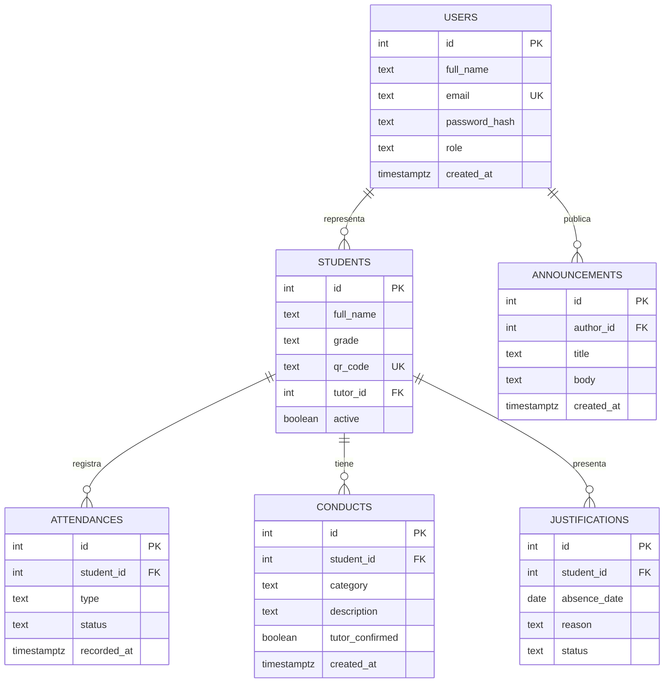

# PRD · Control de Asistencia con QR

> Documento de requisitos del producto (Product Requirements Document).
> Complétalo en el Sprint 0 (historia H0.3) y pide la aprobación del profesor en un Issue.
> Cada requisito funcional (RF) se convierte en un Issue con la plantilla "Historia de usuario".

| Campo | Valor |
| --- | --- |
| Alumno | Vicente Castellón |
| Proyecto n.º | 38 |
| Sitio de referencia | Jibble |
| Compañero revisor | Isaac Ortega |
| URL desplegada | (se completa en el Sprint 5) |

## 1. Problema

Las instituciones educativas pierden tiempo registrando asistencia de forma manual en papel o planillas, lo que genera errores y retrasos. Además, los tutores carecen de visibilidad oportuna sobre la puntualidad de sus representados y los reportes de conducta suelen quedar desorganizados o dispersos.

## 2. Usuarios

- **Usuario principal:** Administrador / Dirección y Encargado de puerta. Necesitan registrar entradas y salidas rápidamente, gestionar alumnos y consultar reportes consolidados. Entran desde PC de escritorio o teléfono móvil.
- **Usuario secundario:** Docente y Tutor. El docente registra incidencias de conducta desde el móvil o PC; el tutor consulta la asistencia, comunicados y faltas de su representado desde su teléfono.

## 3. Objetivo y métrica de éxito

Un encargado registra la entrada o salida de un estudiante escaneando su carnet QR en menos de 3 segundos, reflejando el estado en el panel en tiempo real.

## 4. Alcance del MVP

1. Autenticación y control de acceso por roles (Admin, Docente, Encargado, Tutor).
2. Gestión de estudiantes y generación de carnets con código QR único.
3. Registro de asistencia (entrada, salida y tardanza) por escaneo QR o búsqueda manual.
4. Registro de conducta (méritos y faltas) con confirmación de lectura del tutor.
5. Gestión de justificaciones de inasistencias.
6. Envío de comunicados generales o individuales a tutores.
7. Importación/exportación CSV y panel gráfico de estadísticas.

### Funcionalidades → carpetas de `src/` (screaming architecture) 

| Funcionalidad | Carpeta |
| --- | --- |
| Usuarios y roles | `src/users` |
| Estudiantes y carnets QR | `src/students` |
| Registro de asistencia | `src/attendances` |
| Reportes de conducta | `src/conducts` |
| Justificaciones | `src/justifications` |
| Comunicados | `src/announcements` |

## 5. Fuera de alcance

- Reconocimiento facial o lectores biométricos de huella.
- Envío de mensajes vía WhatsApp o SMS pagados.
- Gestión de notas académicas, boletines o cobro de mensualidades.
- Aplicación móvil nativa (será web responsive).

## 6. Requisitos funcionales

| ID | Requisito | Prioridad (alta, media, baja) |
| --- | --- | --- |
| RF-01 | Iniciar sesión y restringir vistas según el rol del usuario. | Alta |
| RF-02 | Crear, editar, listar y buscar estudiantes, generando su código QR único. | Alta |
| RF-03 | Registrar entrada/salida escaneando el QR con la cámara o buscando por nombre. | Alta |
| RF-04 | Registrar incidencias de conducta (leves, graves, méritos) asociadas a un estudiante. | Media |
| RF-05 | Cargar y aprobar justificaciones de faltas con fecha y motivo. | Media |
| RF-06 | Publicar comunicados visibles para los tutores. | Baja |
| RF-07 | Importar/exportar listas de estudiantes y reportes de asistencia en CSV. | Media |

## 7. Requisitos no funcionales

- Responsive, móvil primero (375 px y 1280 px).
- Lighthouse ≥ 90 en Accesibilidad y Buenas prácticas.
- 0 errores en la consola del navegador.
- Funciona con 10.000 registros sin congelarse.

## 8. Modelo de datos 

## 9. Reto técnico distintivo

Integrar la cámara del dispositivo como periférico para escanear códigos QR en vivo y validar la asistencia contra una estructura en memoria (tabla hash) para respuesta inmediata, además de generar el carnet estudiantil y las gráficas de puntualidad con Canvas/SVG.

## 10. Riesgos y preguntas abiertas

Riesgo: Permisos de cámara bloqueados en navegadores móviles si no se usa HTTPS (se resuelve al desplegar en URL pública con SSL en el Sprint 5 y usando localhost en desarrollo).

Riesgo: Escaneos duplicados en pocos segundos (se mitigará con un tiempo de espera mínimo entre registros del mismo QR).

Pregunta abierta: ¿Los tutores podrán registrarse por su cuenta o únicamente serán creados por el Administrador?