# Ingeniería Inversa · Jibble (y referencia complementaria CyberSheet)

> Análisis realizado con Chrome DevTools sobre **Jibble** (`https://web.jibble.io/get-started`) como sitio de referencia principal para **Control de Asistencia con QR (AsistQR)**

## 1. Hallazgos con DevTools

### Estructura (Elements)
1. **Layout de barra lateral fija + área de contenido:** Jibble separa la navegación principal en un `aside` izquierdo persistente y reserva el contenedor derecho para métricas, onboarding y tablas.
   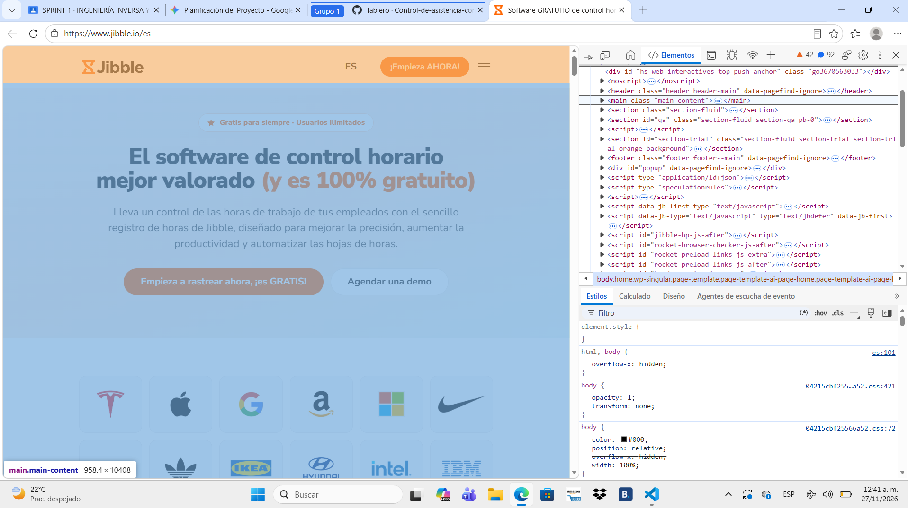
2. **Jerarquía de tarjetas KPI + tabla operativa:** Las vistas principales agrupan resúmenes numéricos en la parte superior (grid de tarjetas) y el detalle de registros debajo, patrón que combinamos con la matriz compacta de CyberSheet.
   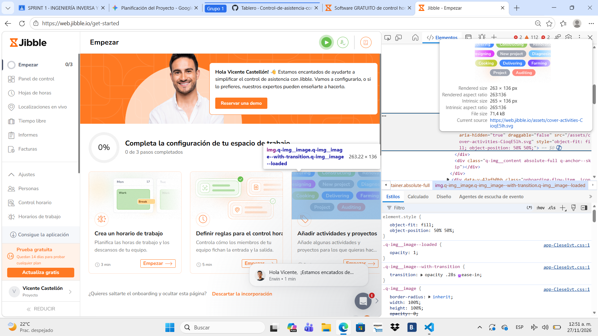

### Sistema de Diseño (Computed / Styles)
3. **Paleta de alto contraste cálido:** Jibble utiliza naranja vibrante como color de acción principal sobre fondos blancos y grises claros. En **AsistQR** lo reemplazamos por pizarra oscuro (`#0f172a`) y verde esmeralda (`#0d9488`).
   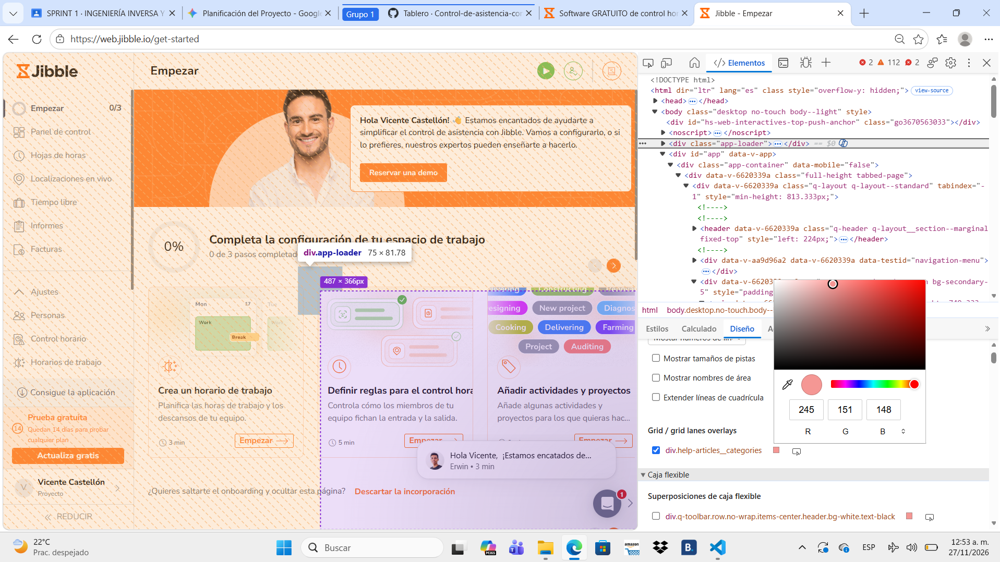
4. **Tipografía web externa:** El sitio original descarga múltiples pesos de fuentes externas (`woff2`), aumentando el tiempo de pintado inicial.
   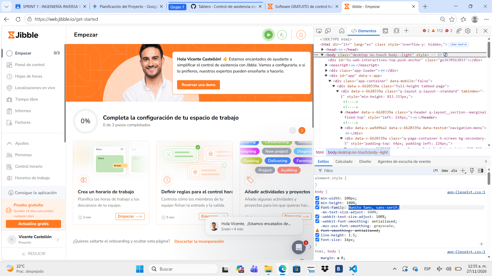

### Red (Network)
5. **Alto número de peticiones iniciales:** Al recargar sin caché (`Ctrl + Shift + R`), Jibble dispara decenas de peticiones entre bundles JS, analítica, chats de soporte y estilos.
   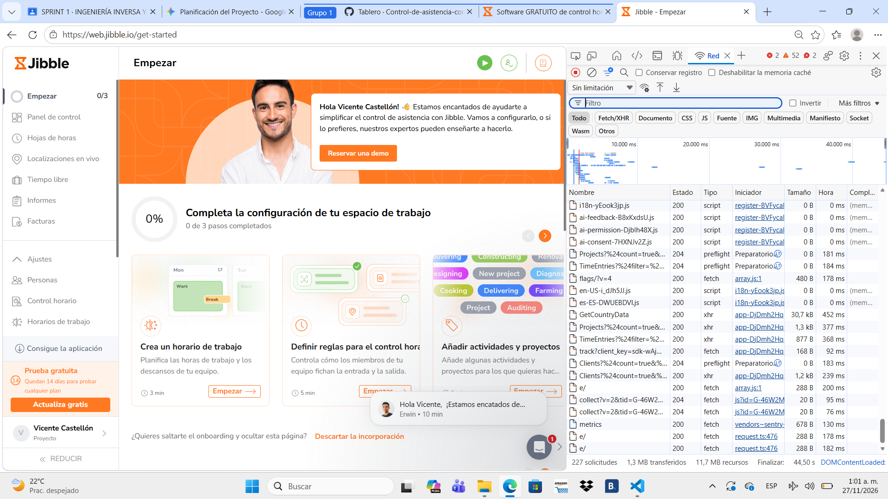
6. **Peso de transferencia elevado:** Los scripts de terceros y librerías de frontend superan varios MB en la carga inicial.
   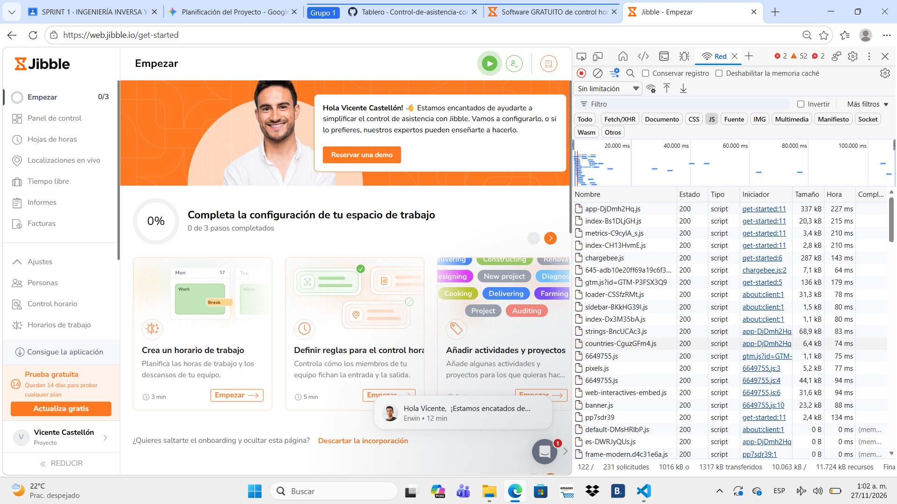

### Estado e Interacción (Application / Console)
7. **Persistencia de sesión y preferencias en el navegador:** El sitio almacena tokens, datos en IndexedDB y configuración de interfaz en `localStorage` y cookies.
   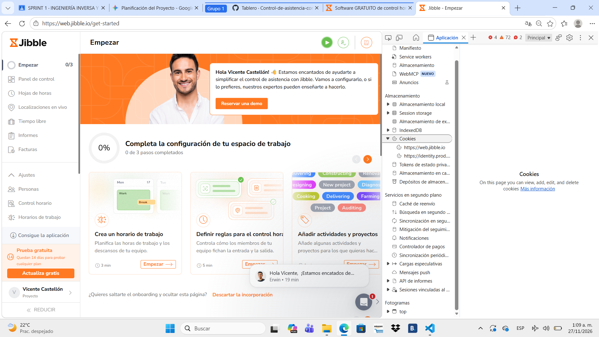
8. **Actualización dinámica sin recargar la página:** El reloj de entrada/salida y los filtros de hoja de tiempos actualizan el DOM al instante mediante JavaScript.
   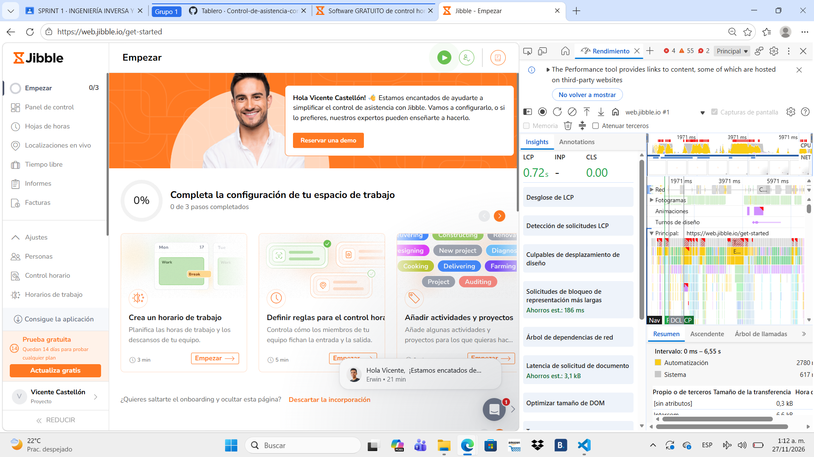

### Auditoría Lighthouse (Original)
9. **Puntaje de Rendimiento crítico (30/100):** El exceso de JavaScript bloqueante, scripts de terceros y recursos pesados penalizan severamente el rendimiento de carga en Jibble.
   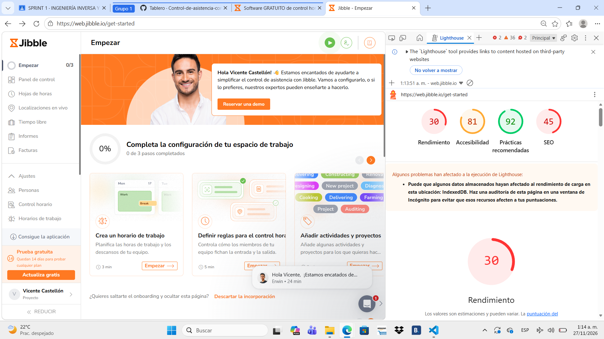
10. **Oportunidades de Accesibilidad (81/100) y SEO (45/100):** Se detectan advertencias en etiquetas accesibles, metadatos y estructura semántica en la auditoría automática.
    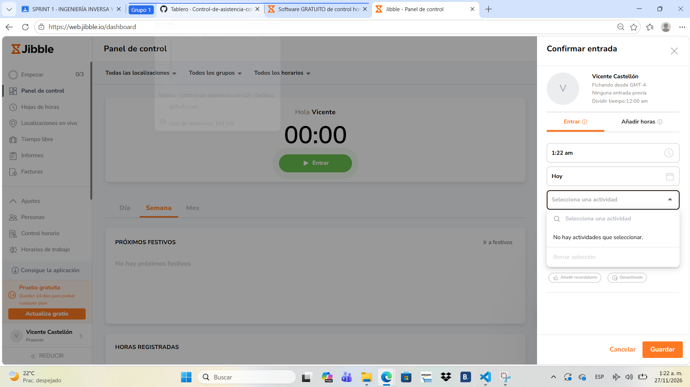

---

## 2. Tres problemas corregidos en `clon/` (AsistQR)

1. **Rendimiento y peso de carga (+70 puntos):** Se eliminaron frameworks pesados, scripts de terceros y fuentes externas. `clon/` usa HTML, CSS y JS puro con SVG en línea, logrando **100/100 en Rendimiento**.
2. **Accesibilidad (+14 puntos) y SEO (+55 puntos):** Se añadieron etiquetas semánticas (`aside`, `nav`, `main`, `section`), atributos `aria-label` en botones y campos de búsqueda, `role="dialog"` en el modal QR, meta descripción y contraste superior a 4.5:1, subiendo a **95/100 en Accesibilidad** y **100/100 en SEO**.
3. **Responsividad real a 375 px y 1280 px:** Se implementó menú colapsable para móvil y contenedores `.table-wrap` con desplazamiento horizontal controlado para que ninguna tabla rompa el ancho de pantalla en teléfonos.

---

## 3. Comparativa Lighthouse (Antes vs. Después)

| Métrica | Jibble (Antes) | AsistQR `clon/` (Después) | Mejora |
| --- | :---: | :---: | :---: |
| Rendimiento | 30 | 100 | +70 |
| Accesibilidad | 81 | 95 | +14 |
| Prácticas recomendadas | 92 | 100 | +8 |
| SEO | 45 | 100 | +55 |

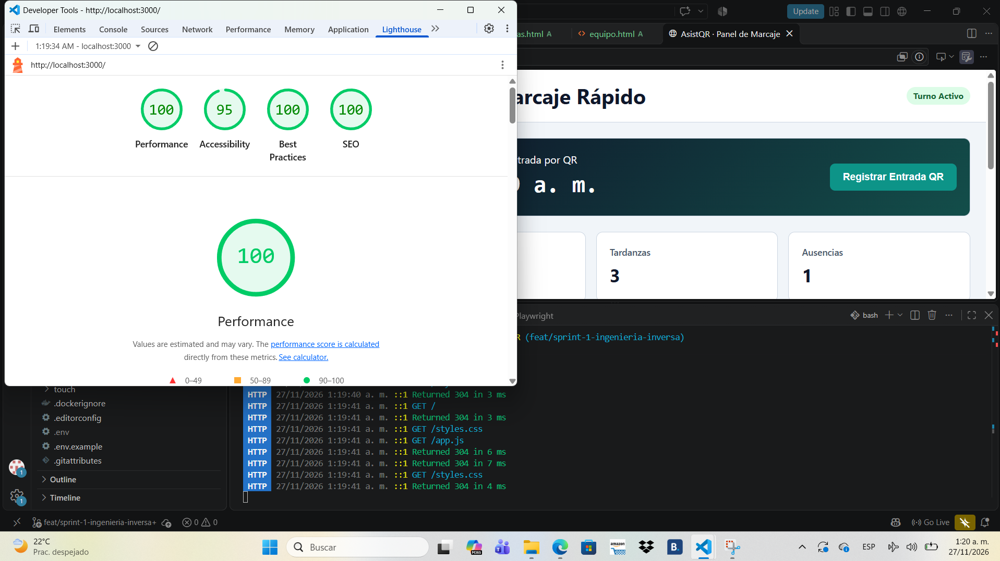 